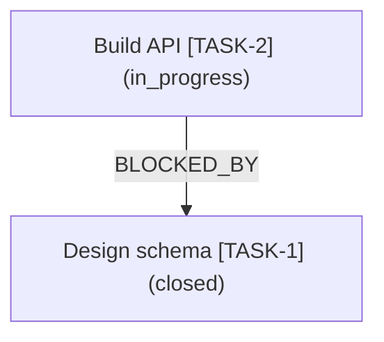

# pm-graph

<picture>
  <source media="(prefers-color-scheme: dark)" srcset="https://raw.githubusercontent.com/unbraind/pm-brand/5c80a2b707f3a00afe986e81e520843b86f3ee83/banners/pm-graph-dark.svg">
  
</picture>

Knowledge graph and dependency graph extension for [pm CLI](https://github.com/unbraind/pm-cli) workspaces, with optional Neo4j sync.

The extension reads item metadata through the pm SDK, then turns items, parent links, `blocked_by` metadata, dependency metadata, tags, statuses, types, assignees, sprints, and releases into graph nodes and relationships.

It can sync that graph into Neo4j, or export it offline to **Mermaid**, **Graphviz DOT**, **JSON Graph**, **Cypher**, **GraphML**, or **PlantUML** via `pm pm-graph export` — with neighborhood (`--root`/`--depth`), edge-type (`--edges`), and node (`--filter type=...|status=...`) shaping.

> **Note:** pm-cli 2026.7.18 introduced a built-in `pm graph` command group (bounded traversals, analytics, and governance audit over the workspace relationship graph). pm-graph complements it with Neo4j sync and multi-format visual/diagram exports. The package's exporter adapter is registered as `graph-export` (`pm graph-export export`) so it does not collide with the core command.

It also ships **offline graph analytics** (no Neo4j required): `pm pm-graph analyze`, `explain`, `cycles`, `path`, `critical-path`, `topo-sort`, and `impact` run dependency-cycle detection, item-centric dependency inspection, shortest-path, longest-chain, topological ordering, downstream-impact, orphan/root/leaf, bottleneck connector, and centrality analysis directly against your workspace.

## Quick Start

**Step 1 — Install the extension:**

```bash
pm install github.com/unbraind/pm-graph
pm pm-graph ping
```

**Step 2 — Configure Neo4j environment variables** (only needed for `sync`, `status`, `query`, `neighbors`):

```bash
export NEO4J_URI=bolt://localhost:7687
export NEO4J_USER=neo4j
export NEO4J_PASSWORD=change-me
```

**Step 3 — Sync your workspace to Neo4j:**

```bash
pm pm-graph sync --json
```

That's it. Open Neo4j Browser at `http://localhost:7474` to explore your graph.

## Install

```bash
pm install github.com/unbraind/pm-graph
pm pm-graph ping
```

To reinstall or update:

```bash
pm install github.com/unbraind/pm-graph --force
```

## Environment Variables

| Variable | Required | Description |
|---|---|---|
| `NEO4J_URI` | Yes (for Neo4j commands) | Bolt URI, e.g. `bolt://localhost:7687` |
| `NEO4J_USER` | Yes (for Neo4j commands) | Neo4j username, e.g. `neo4j` |
| `NEO4J_PASSWORD` | Yes (for Neo4j commands) | Neo4j password |
| `NEO4J_DATABASE` | No | Target database (defaults to server default) |
| `PM_GRAPH_PROJECT_KEY` | No | Override the project key (defaults to workspace directory name) |

The commands `export`, `cypher`, `analyze`, `cycles`, `path`, `critical-path`, `topo-sort`, and `impact`, plus the `graph-export` exporter adapter, do not require Neo4j at all.

## Pure graph projection

TypeScript consumers can call `graphFromItems(items, workspace, extraDependencies)` from `pm-graph`. It builds the same node and relationship shape as the offline export without installing or activating an extension, reading a tracker, or contacting Neo4j. Supply a certified complete, authorization-scoped item collection; the function does not perform those checks for callers. `extraDependencies` is a `Map` keyed by item ID and can be empty when the item metadata already contains its dependencies. The first occurrence of a duplicate `(from, to, type)` relationship supplies its properties.

## Commands

### `pm pm-graph ping`

Verify that the extension is active. Returns the extension version and whether Neo4j is configured.

```bash
pm pm-graph ping --json
```

Example output:

```json
{
  "ok": true,
  "source": "pm-graph",
  "neo4jConfigured": true,
  "version": "0.2.0"
}
```

### `pm pm-graph export`

Export the current workspace as a dependency and knowledge graph in JSON format. Returns `nodes`, `relationships`, and a `projectKey`. **Does not require Neo4j.**

```bash
pm pm-graph export --json
```

Example output (abbreviated):

```json
{
  "ok": true,
  "graph": {
    "generatedAt": "2026-05-14T10:00:00.000Z",
    "workspace": "/path/to/workspace",
    "projectKey": "my-project",
    "nodes": [
      { "id": "TASK-1", "labels": ["PmItem", "task"], "properties": { "title": "Build API", "status": "in_progress" } }
    ],
    "relationships": [
      { "from": "TASK-2", "to": "TASK-1", "type": "BLOCKED_BY", "properties": {} }
    ]
  }
}
```

Pass `--format <cypher|mermaid|dot|json|graphml|plantuml>` to render the graph into an offline format on stdout instead of the default graph object. `--format json` emits a valid JSON Graph (`nodes`/`edges`) document on stdout (parseable with `JSON.parse`), so it is the right choice for piping into other tools. The default (no `--format`) and `--json` behaviours are unchanged.

```bash
pm pm-graph export --format json | jq '.graph.nodes | length'
pm pm-graph export --format mermaid > graph.mmd
pm pm-graph export --format dot --output graph.dot        # write to a file
pm pm-graph export --format graphml --output graph.graphml # GraphML XML for yEd / Gephi / NetworkX
pm pm-graph export --format plantuml --output graph.puml   # PlantUML object diagram
```

Shape the exported graph (works with and without `--format`; once any shaping flag is used, closed/canceled items are excluded unless `--include-closed` is set):

```bash
# Dependency edges only (drop facet + tag edges)
pm pm-graph export --format mermaid --edges deps

# Only tag relationships
pm pm-graph export --format mermaid --edges tags

# 2-hop neighborhood around one item (undirected reachability)
pm pm-graph export --format dot --root TASK-42 --depth 2

# Include closed/canceled items (excluded once shaping is requested)
pm pm-graph export --format json --include-closed

# Scope to Task items that are open or in_progress
pm pm-graph export --format dot --filter type=Task --filter status=open,in_progress
```

| Flag | Values | Default | Description |
|---|---|---|---|
| `--format` | `cypher` \| `mermaid` \| `dot` \| `json` \| `graphml` \| `plantuml` | graph object | Output format. `mermaid` emits a `graph TD` flowchart; `dot` emits Graphviz `digraph`; `json` emits a JSON Graph (`nodes`/`edges`) document; `cypher` reuses the parameterized Neo4j import statements; `graphml` emits a valid GraphML XML document for yEd / Gephi / NetworkX; `plantuml` emits a `@startuml`…`@enduml` object diagram. |
| `--output <file>` | path | — | Write the rendered format to this file instead of stdout (requires `--format`). |
| `--edges <deps\|tags\|all>` | `deps` \| `tags` \| `all` | `all` | `deps` keeps dependency/structural edges (`BLOCKED_BY`, `CHILD_OF`, dependency kinds); `tags` keeps only `TAGGED_WITH`; `all` keeps everything including facet edges. |
| `--root <id>` | item id | — | Restrict the graph to the neighborhood around this node. |
| `--depth <n>` | non-negative integer | unlimited | Max hops from `--root` (undirected). Requires `--root`. |
| `--filter type=...\|status=...` | `key=value[,value]` (repeatable) | — | Keep only PmItem nodes matching the given `type`/`status`. Values for the same key are ORed (including repeated flags); distinct keys are ANDed. Non-item nodes (facets/tags) are always kept. Case-insensitive. |
| `--include-closed` | flag | off (when shaping) | Keep `closed`/`canceled` items once a shaping flag (`--edges`/`--root`/`--depth`/`--filter`) is used. On its own it is a no-op: calls without shaping flags keep the full legacy graph, closed items included. |

### `pm pm-graph cypher`

Render parameterized Cypher statements for importing the current workspace graph into Neo4j. Returns the statements without executing them. **Does not require Neo4j.**

```bash
pm pm-graph cypher --json
```

Example output (abbreviated):

```json
{
  "ok": true,
  "graph": { "nodes": 12, "relationships": 8 },
  "statements": [
    {
      "statement": "MATCH (n:PmGraphNode {projectKey: $projectKey}) DETACH DELETE n",
      "parameters": { "projectKey": "my-project" }
    }
  ]
}
```

### `graph-export` exporter adapter (`pm graph-export export`)

The same offline export pipeline is also registered with pm's native exporter registry under the adapter name `graph-export` (mirroring pm-csv's `csv-export`), which auto-creates the `pm graph-export export [file]` command. It is fully offline and never touches Neo4j.

> Before pm-graph 2026.7.18 the adapter was named `graph` (invoked as `pm graph export`). pm-cli 2026.7.18 introduced a built-in `pm graph` command group, so the adapter was renamed to avoid grafting extension subcommands onto the core command. Note that the auto-generated adapter command currently drops its option contracts on the CLI surface (upstream [pm-cli#574](https://github.com/unbraind/pm-cli/issues/574)) — prefer the canonical `pm pm-graph export`, which exposes the full `--format`/`--output`/shaping flag set documented above.

Example output (`pm pm-graph export --format mermaid --edges deps`):



### `pm pm-graph sync`

Sync the current workspace graph into Neo4j using the `NEO4J_*` environment variables.

- **Default (incremental):** Upserts all nodes and relationships, then deletes stale nodes that are no longer present in the workspace.
- **`--full`:** Performs a complete wipe-and-resync — deletes all `PmGraphNode` entries for the project before re-importing.

After every sync, a `lastSyncedAt` timestamp is stored in a `PmGraphSync` metadata node in Neo4j.

```bash
pm pm-graph sync --json          # incremental
pm pm-graph sync --full --json   # complete resync
```

Example output:

```json
{
  "ok": true,
  "projectKey": "my-project",
  "syncedNodes": 18,
  "syncedRelationships": 11,
  "deletedStaleNodes": 0,
  "fullSync": false
}
```

### `pm pm-graph status`

Show Neo4j configuration status, node and relationship counts for the current project, local pm item count, the last sync timestamp, and the extension version.

```bash
pm pm-graph status --json
```

Example output (Neo4j connected):

```json
{
  "ok": true,
  "neo4jConfigured": true,
  "projectKey": "my-project",
  "workspace": "/path/to/workspace",
  "localItemCount": 15,
  "nodeCount": 18,
  "relationshipCount": 11,
  "lastSyncedAt": "2026-05-14T10:00:00.000Z",
  "syncVersion": "0.2.0",
  "version": "0.2.0"
}
```

Example output (Neo4j not configured):

```json
{
  "ok": true,
  "neo4jConfigured": false,
  "message": "Neo4j is not configured. Set NEO4J_URI, NEO4J_USER, NEO4J_PASSWORD before using this command.",
  "projectKey": "my-project",
  "workspace": "/path/to/workspace",
  "localItemCount": 15,
  "version": "0.2.0"
}
```

### `pm pm-graph query`

Run a **read-only** Cypher query against Neo4j and return JSON results. Destructive Cypher keywords (`CREATE`, `MERGE`, `DELETE`, `DETACH`, `DROP`, `REMOVE`, `SET`) are blocked to prevent accidental data modification.

```bash
pm pm-graph query "MATCH (n:PmGraphNode {projectKey: 'my-project'}) RETURN n.id, n.title LIMIT 10" --json
```

Example output:

```json
{
  "ok": true,
  "count": 2,
  "records": [
    { "n.id": "TASK-1", "n.title": "Build API" },
    { "n.id": "TASK-2", "n.title": "Write tests" }
  ]
}
```

### `pm pm-graph neighbors`

Return all 1-hop neighbors with relationships for a given node ID. Each neighbor includes the relationship type, direction (`outgoing` or `incoming`), and properties.

```bash
pm pm-graph neighbors TASK-42 --json
```

Example output:

```json
{
  "ok": true,
  "center": { "id": "TASK-42", "title": "Deploy service", "_labels": ["PmItem", "task"] },
  "neighbors": [
    {
      "node": { "id": "TASK-10", "title": "Build service" },
      "relationship": { "type": "BLOCKED_BY", "direction": "outgoing", "properties": {} }
    }
  ]
}
```

## Without git

All offline graph commands, including `contract` and `blocker-cuts`, and the graph exporter
work in plain initialized trackers without Git. Neo4j commands need their
documented database configuration and connectivity; they also do not need a
Git repository.

## Offline Analytics

### `pm pm-graph contract <boundary...>`

Collapse nodes with identical declared boundary behavior into summary groups, retaining
all member item IDs and original witness paths. This read-only projection complements
core traversal/topology and existing export shaping: it preserves reachability for
**every ordered pair** of explicit boundaries, including self pairs. It creates no
tracker records, external store, sync plan, or replay journal.

```bash
pm pm-graph contract goal-id prerequisite-id --edges BLOCKED_BY,CHILD_OF --json
pm pm-graph contract goal-id prerequisite-id --edges BLOCKED_BY,CHILD_OF --expand g2 --limit 32
```

The CLI reads a certified complete SDK snapshot with extensions disabled. It retains
all statuses, including custom active and terminal statuses. `--edges` is required:
types select **stored directed arrows**, without reversing dependency kinds or applying
status semantics. Missing selected edge endpoints become visible unknown singletons;
unknown boundary IDs absent from the entire selected view produce a typed refusal.
Boundary and cyclic nodes stay singleton. Cycle rows describe original SCCs; summary
arrows describe existential member-to-member links and may contain additional loops.

Group rows include exact member IDs, inbound/outbound boundary signatures and unknown/
cycle flags. Edge rows include counts and an original endpoint witness; answer rows
include a shortest original node path and matching selected edge types. The SDK checks
all boundary pairs on the quotient before reporting success. Equality of a group's
inbound signature ensures any boundary reaching one member can reach every member;
this invariant propagates across each summary arrow. No removed or invented boundary
path can pass the quotient check. Other questions (metadata, arbitrary member pairs,
edge multiplicity, ontology execution order) require expanding IDs against the source.

JSON and default TOON use the host renderer and output controls. `--limit` (default
100, max 1000) and `--offset` page rows with explicit counts and `nextOffset`;
`--expand <group>` pages membership IDs. A group row keeps its full member list, so
row limits are not a token limit. Use membership pages for large groups. Group IDs
are local to the current snapshot; rerun the same boundaries/edge selection against
an unchanged source when following pages. The projection never claims an atomic
snapshot across separate CLI invocations or a lossless tracker export.

`contractGraph` and `contractionInputFromGraph` are typed SDK exports. One strict
schema rejects unknown fields, sparse arrays, non-finite/fractional/out-of-domain
numeric controls, duplicate node/boundary/type identities and oversized input. Limits:
20000 nodes including missing endpoints, 50000 input edges, 32 boundaries, 64 selected
types, 256 characters per identity, offset <=1000000 and conservative work <=50000000.
Every emitted number is checked before success. Refusals return `ok: false`, empty
rows, exit code 2 and `{code, remedy}`: `INVALID_INPUT`, `WORK_LIMIT`,
`UNKNOWN_BOUNDARY`, `UNKNOWN_GROUP`, `SOURCE_INCOMPLETE`, or `CONTRACT_VIOLATION`.

See the [SDK and CLI example](docs/contraction-example.md) for membership expansion,
contract limits, seeded validation and public-copy reproduction.

### `pm pm-graph blocker-cuts <goal>`

Return alternative **inclusion-minimal blocker frontiers**, smallest cardinality
first, with separate source, graph and search completeness receipts. This is a
graph-view data operation; it complements core dominators/articulation/plan/impact
and this package's path/critical-path commands.

```bash
pm pm-graph blocker-cuts goal-id
pm pm-graph blocker-cuts goal-id --max-cuts 16 --max-states 20000 --json
```

Every upstream unresolved prerequisite path must meet a returned cut. All
prerequisites are conjunctive: for `goal -> a -> {b,c}`, the alternatives are
`[a]` and `[b,c]`. These are **plans**: resolving `b,c` clears the upstream
frontier, but `a` still needs completion. Each cut's `immediatelyUnblocked` is
true only when that set includes every immediate unresolved prerequisite. This
does not predict effort, duration, automatic task completion, or approvals.

The command uses an extension-free, strict, full, unbounded SDK read (including
terminal items), and exact goal ids. `BLOCKED_BY`, `DEPENDS_ON`, `REQUIRES` and
reversed `BLOCKS` are prerequisites; hierarchy, related links and facets are
excluded. Terminal statuses from the tracker registry stop traversal. A resolved
goal or a goal with no active blockers returns the empty cut `[[]]`.

`source` certifies the read, while `receipt.graph` describes the active goal cone
in that supplied snapshot. It cannot prove that missing real-world relationships
were recorded, nor provide transaction isolation from concurrent tracker edits.
Unknown referenced items/statuses refuse with `INCOMPLETE_GRAPH`; a relevant
cycle refuses with `CYCLE` and one closed cycle witness. Unrelated cycles and
missing references outside the active cone do not prevent a goal proof.
Missing-data receipts include total counts and at most 32 example ids per kind.

`receipt.search.complete` means **all** inclusion-minimal cuts were enumerated.
`completeThroughSize` certifies fully searched cardinalities;
`minimumCardinality` is the proven smallest size, or `null` if no cut was found.
Partial results remain individually minimal. Never interpret an empty partial
list as "unblocked". To act on displayed rows, also inspect the host's
`read_output` receipt: output compaction is independent of search completeness.

| Budget | Default | Hard maximum |
| --- | ---: | ---: |
| `--max-states` (candidate subsets) | 20000 | 1000000 |
| `--max-work` (search visits, edges, subset comparisons) | 2000000 | 20000000 |
| `--max-cuts` (returned alternatives) | 32 | 256 |
| `--max-size` (frontier cardinality) | 8 | 64 |

Enumeration stops deterministically at the first cap and reports its name;
raising that budget and rerunning restarts the search. Preflight scans are
input-capped at 100000 nodes / 500000 relationships and 512 active unresolved
vertices. Oversized snapshots refuse with `GRAPH_LIMIT` and a scoping remedy.
`INVALID_OPTIONS`, `INVALID_GRAPH`, `UNKNOWN_GOAL`, and `SOURCE_INCOMPLETE` also
include remedies. CLI refusals exit 2 (unknown goals exit 3); successful bounded
searches exit 0, with partiality explicit in the receipt.

The typed SDK has no filesystem, Git or Neo4j dependency:

```ts
import { minimalBlockerCuts } from "pm-graph";
import type { BlockerCutResult } from "pm-graph";

const result: BlockerCutResult = minimalBlockerCuts(snapshot, "goal-id", {
  maxCuts: 16,
  // For custom workflows, pass disjoint resolvedStatuses/unresolvedStatuses.
});
if (!result.ok) console.error(result.refusal.code, result.refusal.remedy);
else renderFrontiers(result.cuts, result.receipt);
```

SDK callers must certify their own complete source read; the pure function only
certifies the supplied goal cone. Successful results contain ids and receipts,
excluding item bodies, titles and local paths. `SOURCE_INCOMPLETE` remedies retain
the original source error message to distinguish invalid roots, strict-read
failures and bad settings; these diagnostics can include tracker paths.
See [the worked example](docs/blocker-cuts-example.md).

### Other offline analytics

The following commands analyze the workspace dependency graph **entirely offline** — no Neo4j required. They operate on **structural edges only** (`BLOCKED_BY`, `CHILD_OF`, and dependency edges such as `BLOCKS`/`RELATED`) between real items; facet edges (type/status/assignee/sprint/release) and tag edges are deliberately excluded so cycle, path, and centrality results stay meaningful.

Closed/canceled items are excluded by default; pass `--include-closed` to keep them. `analyze`, `cycles`, `critical-path`, and `topo-sort` also accept `--root <id>` / `--depth <n>` to scope the analysis to a neighborhood. `analyze`, `cycles`, `critical-path`, `topo-sort`, `path`, `impact`, and `explain` accept `--filter type=...|status=...` to keep only items matching the given type/status (same-key values are ORed; distinct keys are ANDed); non-item nodes (facets/tags) are always kept. `cycles` and `critical-path` additionally accept `--format <text|mermaid|graphml|dot>` (default `text`) to render the relevant subgraph as a diagram for docs — `dot` emits a Graphviz `digraph` consumable by `dot`, `neato`, etc.

The host dependency contract stores `A --blocked_by--> B` and `B --blocks--> A`
as the same prerequisite: A waits for B. Offline analytics normalize `BLOCKS`
to item → blocker direction before computing paths, cycles, execution order,
impact, depth, and explanations. Graph exports and diagram relationships retain
their original stored endpoints and relation types. The edge-array SDK helpers
(such as `topoSort`) expect this normalized item → blocker direction.

### `pm pm-graph analyze`

Comprehensive graph-health report: dependency-cycle count, orphan items (no edges), root items (no incoming dependency), leaf items (no outgoing dependency), longest dependency chain, top-N degree-centrality items, connected-component count, blocked-item count, and bottleneck connectors.

```bash
pm pm-graph analyze --json
pm pm-graph analyze --root pm-ep18 --depth 2 --json
pm pm-graph analyze --include-closed --json
```

Example output (abbreviated):

```json
{
  "ok": true,
  "itemCount": 7,
  "structuralEdgeCount": 6,
  "cycleCount": 1,
  "cycles": [["pm-oj3m", "pm-zc3a", "pm-oj3m"]],
  "orphans": ["pm-op0k"],
  "roots": ["pm-ep18"],
  "leaves": ["pm-hd71"],
  "longestChainLength": 4,
  "longestChain": ["pm-ep18", "pm-k849", "pm-p2q3", "pm-hd71"],
  "connectedComponents": 3,
  "blockedItemCount": 5,
  "topDegreeCentrality": [{ "id": "pm-ep18", "degree": 2, "inDegree": 0, "outDegree": 2 }],
  "maxDepth": 3,
  "depthByItem": [{ "id": "pm-hd71", "depth": 3 }, { "id": "pm-p2q3", "depth": 2 }],
  "articulationPoints": ["pm-p2q3"],
  "bridgeEdges": [{ "from": "pm-k849", "to": "pm-p2q3" }]
}
```

The `maxDepth` and `depthByItem` fields report the **dependency depth** of each item — the number of edges on the longest directed structural path starting at the item (its distance to a leaf along blocker edges). A leaf has depth `0`; `maxDepth` equals the critical-path depth. `depthByItem` is sorted deepest-first. These fields are additive; all previously emitted fields are unchanged.

The `articulationPoints` and `bridgeEdges` fields report bottlenecks in the
undirected structural projection: an articulation point is an item whose removal
disconnects part of the dependency context, and a bridge edge is a structural
item-to-item link whose removal does the same. These are useful for spotting
single points of coordination failure in a large pm workspace.

### `pm pm-graph cycles`

Detect and list dependency cycles. Each cycle is printed as an ordered id path (first id equals last). **Exits with code 1 when any cycle exists** (so it can gate CI) and exits 0 when there are none.

```bash
pm pm-graph cycles                     # human-readable; exit 1 if cycles found
pm pm-graph cycles --json              # machine-readable
pm pm-graph cycles --format mermaid    # render the cycle subgraph as Mermaid, then exit 1
pm pm-graph cycles --format graphml    # render the cycle subgraph as GraphML, then exit 1
pm pm-graph cycles --format dot       # render the cycle subgraph as a Graphviz digraph, then exit 1
pm pm-graph cycles --filter type=Task # scope to Task items only before detecting cycles
```

```jsonc
// no cycles -> exit 0
{ "ok": true, "cycleCount": 0, "cycles": [] }
```

Pass `--format mermaid`, `--format graphml`, or `--format dot` to visualize **only the cycle-participating** nodes and edges (the union of every detected cycle) as a diagram. The diagram is printed to stdout first, then the command still **exits 1** so it keeps gating CI. The subgraph is rendered with the same renderers as `pm graph export`, so it embeds directly in docs. `--format text` (the default) is unchanged. When there are no cycles, `--format` is a no-op (an empty diagram is meaningless) and the normal exit-0 result is returned.

### `pm pm-graph path`

Shortest **directed** dependency path between two item ids via BFS over structural edges. Missing arguments yield a usage error (exit 2); an unknown id yields a not-found error (exit 3).

```bash
pm pm-graph path pm-ep18 pm-hd71 --json
```

```json
{ "ok": true, "from": "pm-ep18", "to": "pm-hd71", "found": true, "path": ["pm-ep18", "pm-hd71"], "length": 1 }
```

### `pm pm-graph explain`

Explain one item in a single offline report: immediate blockers, immediate dependents, transitive downstream impact, dependency depth, critical chain from the item, and cycle participation.

```bash
pm pm-graph explain pm-ep18 --json
pm pm-graph explain pm-ep18 --include-closed --json
```

```json
{
  "ok": true,
  "id": "pm-ep18",
  "item": { "id": "pm-ep18", "title": "Platform baseline", "type": "Task", "status": "in_progress" },
  "blockers": [{ "id": "pm-k849", "title": "Schema migration", "relationTypes": ["BLOCKED_BY"] }],
  "dependents": [{ "id": "pm-y7ht", "title": "Write docs", "relationTypes": ["BLOCKED_BY"] }],
  "transitiveDependents": ["pm-y7ht", "pm-z19r"],
  "dependencyDepth": 2,
  "criticalChainFromItem": ["pm-ep18", "pm-k849", "pm-p2q3"],
  "inCycle": false,
  "cycleCount": 0,
  "cycles": []
}
```

If the id is unknown, the command returns a not-found error and includes nearest id suggestions when available.

### `pm pm-graph critical-path`

The longest chain of blocking dependencies through the workspace — the critical path — as an ordered id list with its length. Cycle-safe.

```bash
pm pm-graph critical-path --json
pm pm-graph critical-path --format mermaid     # render the critical-path chain as Mermaid
pm pm-graph critical-path --format graphml     # render the critical-path chain as GraphML
pm pm-graph critical-path --format dot          # render the critical-path chain as a Graphviz digraph
pm pm-graph critical-path --filter type=Epic    # scope the critical path to Epic items
```

```json
{ "ok": true, "length": 4, "path": ["pm-ep18", "pm-k849", "pm-p2q3", "pm-hd71"] }
```

Pass `--format mermaid`, `--format graphml`, or `--format dot` to print the critical-path **chain** as a diagram — exactly the chain nodes plus the edges connecting them — to stdout, reusing the same renderers as `pm graph export`. `--format text` (the default) returns the result object unchanged.

### `pm pm-graph topo-sort`

Emit a valid **topological execution order** of items over structural edges (Kahn's algorithm), so each item is listed only after the items it depends on. Ties are broken by ascending id for deterministic output. **Exits with code 1 when a dependency cycle prevents a complete ordering** (CI-usable), reporting the cycle members and the resolvable prefix. Accepts `--root`/`--depth`/`--include-closed`.

```bash
pm pm-graph topo-sort --json
```

```json
{
  "ok": true,
  "count": 6,
  "cyclic": false,
  "order": ["pm-p030", "pm-ijd7", "pm-vc4q", "pm-yol1", "pm-0wtl", "pm-8k1m"]
}
```

### `pm pm-graph impact`

List every item **transitively blocked-by / downstream** of a given item id — the reverse-reachable set following edge direction. Complements `path` and `neighbors`. A missing id yields a not-found error (exit 3); no id yields a usage error (exit 2).

```bash
pm pm-graph impact pm-vc4q --json
```

```json
{ "ok": true, "id": "pm-vc4q", "count": 3, "impacted": ["pm-0wtl", "pm-8k1m", "pm-yol1"] }
```

## Snapshot graph change impact

`compareGraphSnapshots(before, after, goal, options?)` compares two explicit
`Graph` SDK values. The CLI accepts regular JSON files containing those values
or the existing export command's `{ graph: ... }` envelope:

```bash
pm pm-graph snapshot-impact before.json after.json goal-id --limit 16 --json
pm pm-graph snapshot-impact before.json after.json goal-id --limit 16 --offset 16
```

The result reports gained/lost upstream prerequisites and downstream dependents,
added/removed minimal blocker frontiers, and explicit `SUPPORTS`/`EVIDENCE_FOR`
links into the goal or its upstream prerequisites. Removed facts carry the
earlier node title and status, even if that node was deleted. A deleted goal is
valid when it exists in the earlier snapshot. Reordering inputs, duplicate
edges and nonsemantic title/capture metadata edits produce no changes.

The gating policy is `BLOCKED_BY`, `DEPENDS_ON`, `REQUIRES`, and reversed
`BLOCKS`; hierarchy, facets and other relationships do not imply prerequisites.
Reachability is structural, including terminal items. Blocker frontiers stop
at terminal items and require all upstream paths to intersect a cut. Resolving
a frontier still leaves intermediate work; `immediatelyUnblocked` identifies
cuts containing every direct prerequisite. Both cut searches must finish before
differences are reported. Cycles, missing cone endpoints, unknown active statuses
and exhausted cut searches return typed refusals with remedies. A dangling
reference to a deleted node retains its earlier explanation in `missingNode`
while refusing to infer cut differences from incomplete input. For custom
workflows, pass `cutOptions.resolvedStatuses`/`unresolvedStatuses` in the SDK or
`--resolved-statuses done,canceled --unresolved-statuses ready,working` in the CLI.

`receipt.output` exposes the exact total, returned/omitted counts and
`nextOffset`. Keep both input files immutable while recovering pages.
Defaults are 32 rows and 2,000,000 traversal work units; `--limit` accepts
1..256 and `--max-work` accepts 1..20,000,000. Cut budgets have separate
`--cut-max-states`, `--cut-max-work`, `--cut-max-cuts` and `--cut-max-size` flags
(defaults: 20,000 / 2,000,000 / 32 / 8). Each snapshot is limited to 10,000 nodes,
50,000 relationships and, for CLI files, 16 MiB. The active blocker cone is
limited to 512 unresolved items including the goal; this is a preflight cap,
not a completion guarantee. Completion requires `--cut-max-size` (default 8,
hard cap 64) to be at least the number of unresolved prerequisites in the
active cone, excluding the goal. A chain of 9 unresolved prerequisites therefore
returns `CUT_SEARCH_INCOMPLETE` with defaults; more than 64 cannot complete
under the current search. Other cut budgets can stop even smaller searches.
Explanation titles/statuses are clipped to
160/64 Unicode code points with `textClipped: true`; ids are limited to 256
characters. The host's JSON/TOON projection and token budgets also apply to the
declared `changes` rows. Refusals exit 2 (unknown goal: 3) and preserve
`refusal.code`, `refusal.remedy` and the failing side.

This is a comparison over the supplied snapshots. Core owns snapshot capture
and storage; pm-context owns resume packets. Certify backend reads separately
(for example with `listAllComplete`) before `graphFromItems` projection. The
projection includes item relationships and facets; evidence nodes and support
edges must be supplied explicitly by the caller's backend. Support is a linked
structural assertion, not verification of a document, file, test run or URL.
The comparison never accesses those resources or either live backend.

See the [SDK and CLI example](docs/snapshot-impact-example.md) and the
[public tracker validation](docs/snapshot-impact-validation.md).

## Without git

Graph projection, consent-scoped `project`, export, offline analysis, path/impact/explain and snapshot
comparison work in plain trackers. Snapshot comparison reads only the two
explicit JSON files and also works without a tracker. Neo4j operations require
their configured database connection. None of these graph operations needs a
git repository; the no-git regression runs the installed CLI with git absent
from PATH.

## Graph Model

- **`PmItem`** nodes for real pm items, labelled with item type (e.g. `task`, `bug`).
- **`ExternalPmItem`** nodes for dependency targets referenced but not present in the current workspace.
- **`PmFacet`** nodes for metadata: type, status, assignee, sprint, release, and tags.
- **`PmGraphSync`** metadata node storing the last sync timestamp and extension version per project.

Relationships: `CHILD_OF`, `BLOCKED_BY`, dependency relationship types from `pm deps`, `HAS_TYPE`, `HAS_STATUS`, `ASSIGNED_TO`, `IN_SPRINT`, `IN_RELEASE`, `TAGGED_WITH`.

All nodes in Neo4j carry the label `PmGraphNode` in addition to their semantic labels, making it easy to scope queries to a project:

```cypher
MATCH (n:PmGraphNode {projectKey: 'my-project'}) RETURN n LIMIT 25
```

## Error Handling

- Missing environment variables produce clear messages listing exactly which variables are unset.
- Neo4j connection failures (unreachable host, wrong credentials) produce actionable error messages rather than raw driver errors.
- The `query` command blocks destructive Cypher keywords to protect data integrity.
- The Neo4j driver is created with `connectionAcquisitionTimeout: 10s` and `maxConnectionLifetime: 5min`.
- Driver sessions are always closed in `finally` blocks to prevent connection leaks.

## Development

```bash
cd /path/to/pm-graph
npm install
npm run build
pm install --project .
pm pm-graph ping
```

Run `npm run release:check` and `bun run release:check` before submitting changes.
The coverage gate inventories authored runtime TypeScript throughout the repository,
including root modules and executable scripts. Dependencies, build output, tracker
metadata and test fixtures are structural exclusions; runtime exemptions and
coverage suppression pragmas are rejected. Every configured test pattern must match
files, and every selected file must declare a passing test. Skipped or TODO tests
and suites fail the gate, including empty skipped suites.

## Release Automation

This package supports GitHub, npm, and Bun-compatible installs. Publication remains blocked until the independently tracked full-history privacy and repository-wide exact coverage/source-quality gates are resolved. CI runs type checking, build, production dependency audit, package packing, Bun install verification, and pm-changelog validation. The daily release workflow publishes only when commits exist after the latest release tag and uses pm-changelog to generate CHANGELOG.md and GitHub release notes.

## Multi-agent merge safety

This repo tracks its project management in `.agents/pm/` and ships a committed `.gitattributes`
that maps those tracker artifacts to pm-cli's field-aware Git merge drivers, so concurrent-branch
tracker edits merge cleanly instead of hard-conflicting. The driver definitions live in per-clone
Git config; `npm install` / `npm ci` wires them automatically via the `prepare` script, `scripts/prepare-merge-driver.ts`: the launcher template pm-ops ships, copied unchanged, which a test compares byte for byte with the pinned template. It runs pm-ops's installer, which calls `pm merge install` when the `pm` CLI is on `PATH` and skips with a notice when it is not. A production install of a clone (`npm ci --omit=dev`) has no `pm-ops`, so the launcher skips with one notice, while a stale or broken `pm-ops` fails the install. Registry installs of this package never run `prepare`. Being Node-based, it behaves identically on POSIX shells and Windows `cmd.exe`. To (re)run manually: `npm run merge:install`.

After merging a branch that touched `.agents/pm/`, reconcile any residual history-hash drift with
**`pm merge reconcile`** (pm-cli ≥ 2026.7.22): preview with `pm merge reconcile --dry-run`, apply with
`pm merge reconcile --message "post-merge reconcile"`, then confirm with `pm validate`, which scans the
whole tracker and flags remaining history drift across **every** affected item (`pm merge reconcile`
itself lists each affected stream in its output; `pm history --verify <id>` spot-checks one item). The field-aware driver already unions every author's
content, so `reconcile` only re-greens the hash chain (no data loss) — see the authoritative
[pm-cli merge-safety guide](https://github.com/unbraind/pm-cli/blob/main/docs/MERGE_SAFETY.md). The
older blunt `pm history-repair --all` remains available as a lower-level primitive.

## Universal read output controls

Requires pm CLI/SDK **2026.10.13 or later**. Read commands accept the host's
`--output-include`, `--output-limit`, `--output-budget`, `--output-format`,
`--output-session`, `--output-cursor`, and `--output-row-contract` controls.
Use `pm contracts --command "pm-graph export" --full` to discover the row paths.

Ordinary document and diagram formats retain their existing rendering. When
universal controls are supplied, handlers return structured results so the host
owns projection, omission receipts, budgets, and continuation. `--output` file
writing cannot be combined with these controls. Writers remain undeclared.
An infeasible budget returns `output_budget_exceeded` and CLI exit 2; increase
the budget before using the result. Budget-compacted declared rows include
per-path continuation cursors: repeat the same semantic inputs with
`--output-cursor`, keeping the tracker unchanged, until no cursor remains.
`--output-limit` is an amount ceiling; cursor recovery applies to budget
compaction. Command-local selection limits and document budgets still apply.

### Adoption recipe

1. Pin the development SDK to 2026.10.13 and align the peer and manifest floor.
2. Declare `read_output: { row_keys: [...] }` on readers only; use actual,
   non-overlapping array or object-map paths, or `[]` for a singleton.
3. Return a structured object. Keep raw document rendering on its ordinary
   path, declining the output service when canonical controls are requested.
   Prevent file writes and unbounded diagram stdout on that path.
4. Test the packed extension through its installed host against real temporary
   trackers: projection, budget omission, every-row cursor recovery, and writer
   rejection. Remove only the declarations, rebuild, and prove the tests fail.
5. Run unchanged npm and Bun release gates and document their exact results.


## Triplicate visual identity

Visual exports use build-time values from the exact `pm-brand` development pin:
form paper, carbon ink, ruled item sheets and explicit status fills. Portable font
stacks put Archivo, Public Sans and Martian Mono first and fetch no external fonts.
[Design, themes, token parity and reproducible review renders](docs/triplicate-visuals.md).
The README banner embeds pm-brand's committed output at an immutable SHA.

## Consent-scoped cross-workspace projection

`pm pm-graph project projection.json --limit 100 --json` reads only explicitly
consented trackers into a read-only item graph. The typed `projectWorkspaces`
SDK also accepts database readers bound to existing core authorization. Qualified
IDs preserve workspace identity; cross-workspace evidence needs separate consent
and two visible endpoints. Denied or incomplete sources yield opaque boundaries,
with no hidden node IDs, labels or source exception text. Source completeness
and output omission receipts remain separate. JSON and compact TOON use the
host's standard output controls. See the [manifest and SDK example](docs/cross-workspace-example.md)
for scope, authorization, pagination, refusal remedies and limits.
